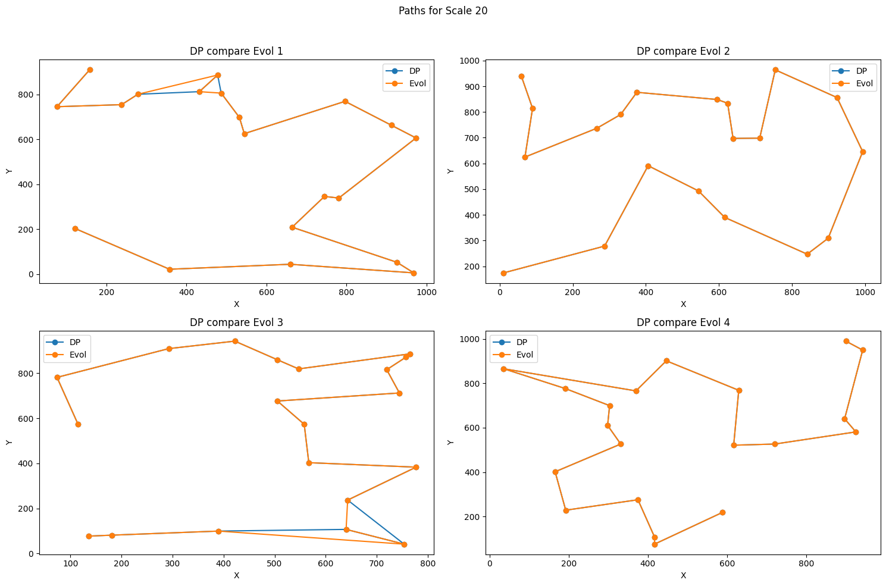
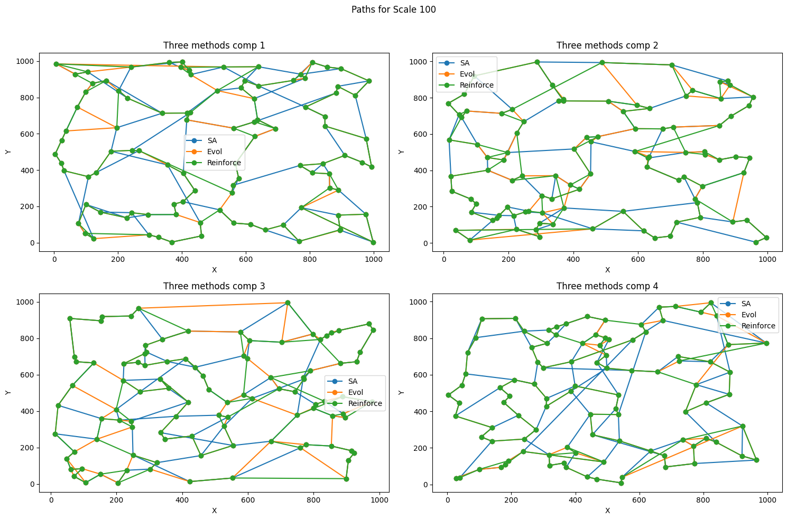

# Path Optimization Benchmark

A benchmark for comparing exact and heuristic approaches to an open-path variant of the traveling salesperson problem. The project includes C++ implementations, a Python reinforcement-learning experiment, saved datasets and results, and Jupyter notebooks for analysis and visualization.

Given a set of two-dimensional points, the task is to visit each point exactly once while minimizing the total Euclidean path length. **The path does not return to its starting point.**

## Methods

- **Dynamic programming (DP):** an exact subset-based baseline for small instances.
- **Simulated annealing (SA):** a stochastic search that explores permutations by swapping points.
- **Evolutionary algorithm (Evol):** a population-based search using selection, crossover and mutation.
- **Reinforcement-learning experiment (Reinforce):** a Python implementation that learns preferences for selecting the next point from sampled paths.

## Quick start

### Build the C++ programs

Requirements: CMake 3.21 or later and a C++17 compiler. From this directory:

```powershell
cmake --preset default
cmake --build --preset default
```

With the Visual Studio generator on Windows, executables are placed in `build/Release/`. Other generators may place them directly in `build/`.

### Run an example

Each executable accepts an input file and an output prefix. For example, using the Visual Studio build:

```powershell
.\build\Release\dp.exe .\data\5\1.in .\runs\std\5\example
.\build\Release\SA.exe .\data\5\1.in .\runs\SA\5\example
.\build\Release\evol.exe .\data\5\1.in .\runs\evol\5\example
```

Each command writes a path-length file (`.out`) and a path file (`.ans`). Choose a fresh output prefix for each run: the programs refuse to overwrite an existing result. The DP implementation accepts 2–20 points; SA and Evol accept 2–100. The heuristic programs use fixed iteration settings and can take considerable time.

The optional `data_generator` executable creates one shuffled 100-point special case and its reference files at a fresh output prefix:

```powershell
.\build\Release\data_generator.exe .\runs\special-example
```

An input file starts with the number of points, followed by one `x y` coordinate pair per line. Results are stored under `runs/`; choose an unused output prefix to preserve existing files.

### Notebooks

Start Jupyter from the repository root or the `code/` directory with Python, NumPy, Matplotlib, pandas and IPython installed.

- `code/reinforce.ipynb` trains on the four special instances by default and writes new results to `runs/reinforce/spe/` with `new_` filenames. Change the output filenames before repeating a run.
- `code/comp.ipynb` reads the saved historical results, calculates the comparison table, and displays route plots. It displays the computed table without replacing the saved summary.

## Problem formulation

For points $p_1,\ldots,p_n$ and a permutation $\pi$, the objective is

$$
\min_{\pi}\; L(\pi) = \sum_{i=1}^{n-1} \lVert p_{\pi_i} - p_{\pi_{i+1}} \rVert_2.
$$

DP stores the minimum length of a path that visits a subset $S$ and ends at $j$:

$$
D(S,j) = \min_{i \in S\setminus\{j\}}\left[D(S\setminus\{j\},i) + d(i,j)\right],
\qquad D(\{j\},j)=0.
$$

The result is $\min_j D(V,j)$. The exponential state space limits this baseline to small instances. The heuristic implementations search for short paths without an optimality guarantee. The reinforcement-learning notebook uses sampled trajectories and learned point-to-point preferences; it should be read as an experiment, rather than a claim of a standard Q-learning implementation.

## Experimental results

The saved experiment contains 20 generated instances at each of five sizes (5, 10, 20, 50 and 100 points), plus four specially constructed 100-point instances. The table reports the mean per-instance relative difference in path length:

$$
\text{Relative difference} = \frac{L_{\text{method}}-L_{\text{baseline}}}{L_{\text{baseline}}}\times 100\%.
$$

Lower values indicate shorter paths relative to that row's baseline. **The baseline changes between groups:** DP for 5–20 points; Evol for 50 and 100 points; and the saved reference values for the special cases. The large-instance numbers therefore are not gaps to a known optimum.

| Instances | Baseline | SA | Evol | Reinforce |
|---|---|---:|---:|---:|
| 5 points | DP | 0.00% | 0.00% | -0.00% |
| 10 points | DP | 0.78% | 0.01% | 0.22% |
| 20 points | DP | 6.63% | 1.02% | 4.45% |
| 50 points | Evol | 5.93% | 0.00% | 1.68% |
| 100 points | Evol | 13.21% | 0.00% | 3.15% |
| Special cases | Saved reference | 516.56% | 2.61% | 65.78% |

Values are reproduced from `runs/performance_comparison.csv`; rounding can produce `-0.00%`. The special-case values are averages across four constructed examples and should not be generalized to other datasets. The historical experiment used approximate time budgets described in the project presentation, but the current programs use fixed iteration settings; the saved results have not been independently reproduced with the current command-line interface.

### Example paths

The following figures are saved outputs from `code/comp.ipynb`. Overlapping lines may hide one method's route.

**20 points — DP and evolutionary algorithm:**



**100 points — simulated annealing, evolutionary algorithm and reinforcement learning:**



## Repository layout

```text
.
├── CMakeLists.txt, CMakePresets.json  # Build configuration
├── code/                            # C++ sources and Jupyter notebooks
│   ├── dp.cpp, SA.cpp, evol.cpp, paths.h
│   ├── data.cpp                     # Special-case dataset generator
│   └── reinforce.ipynb, comp.ipynb
├── data/                            # Input instances (.in)
├── figures/                         # Selected historical notebook outputs
└── runs/                            # Baselines, algorithm results and summary
    ├── std/                         # Reference results
    ├── SA/, evol/, reinforce/       # Results by method
    └── performance_comparison.csv
```

## Limitations

- Only the DP implementation is an exact solver; the other approaches do not certify optimality.
- The saved comparison uses different baselines across instance groups and should not be interpreted as a single optimality-gap benchmark.
- The figures and table describe existing runs, not repeated trials with confidence intervals or a controlled comparison of current execution times.
- The figures and numerical results are historical; new heuristic runs may differ because the algorithms use fixed iteration settings and stochastic search.
